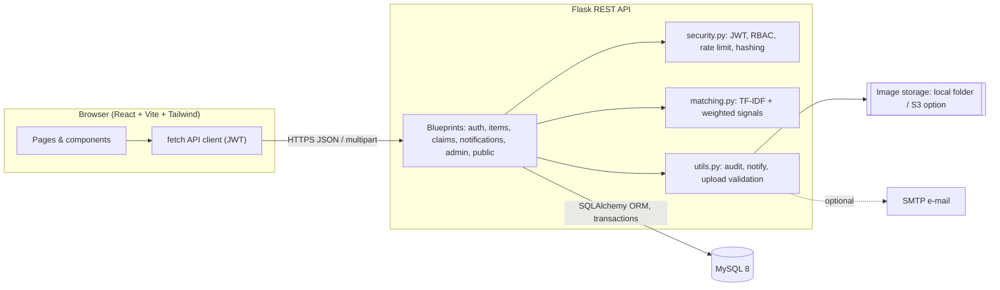
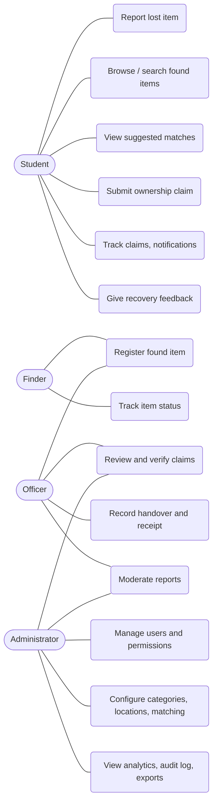
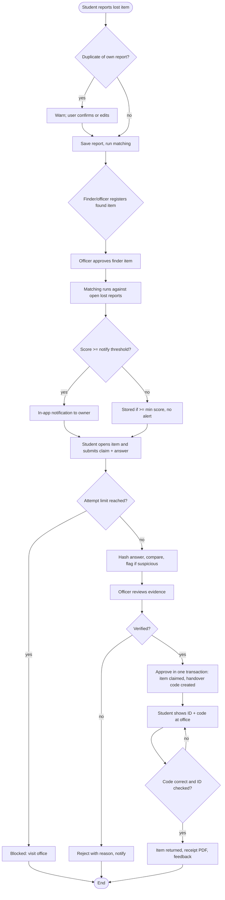
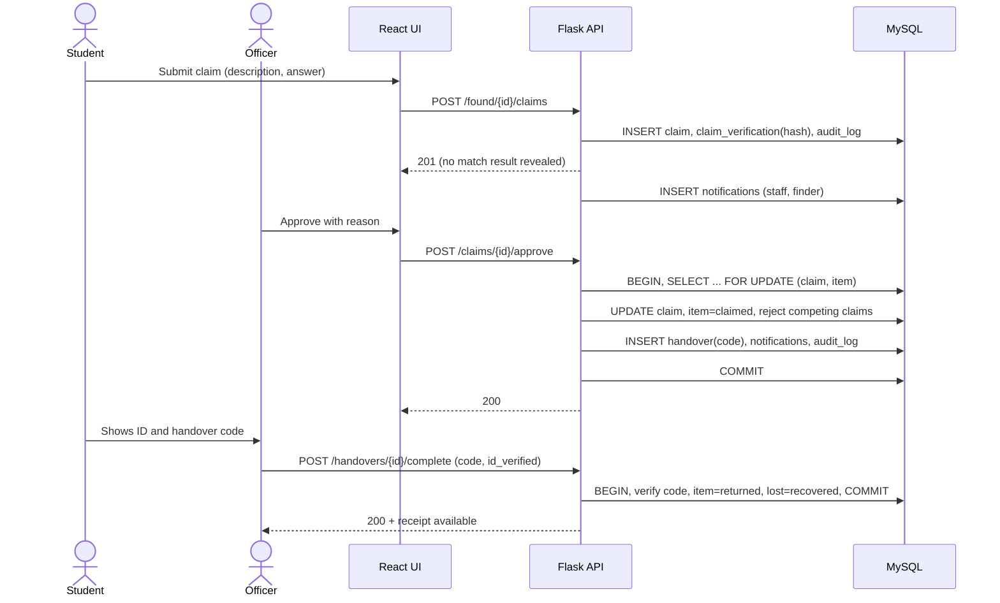
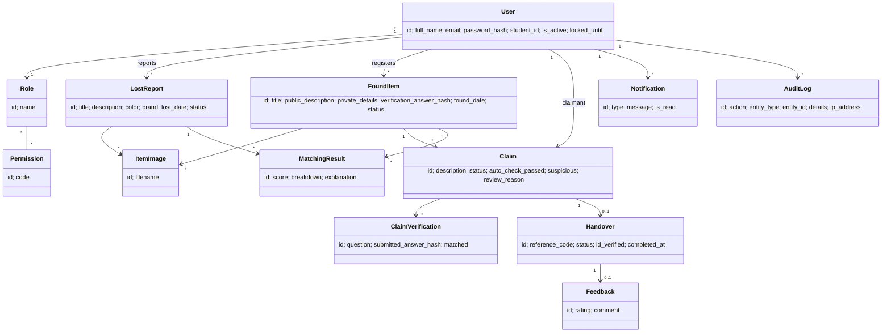
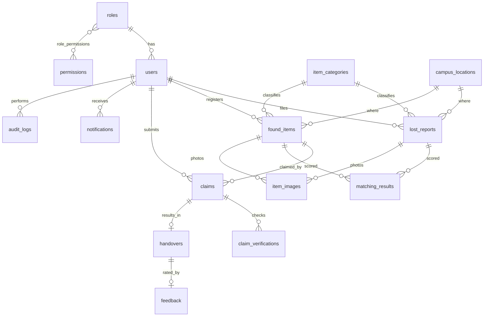

# UML, ER and architecture diagrams

All diagrams are Mermaid (render in VS Code with the *Markdown Preview Mermaid Support* extension, on GitHub, or export PNGs with `mmdc`). PNG exports are in `docs/diagrams/`.

## 1. System architecture

## 2. Use-case diagram

## 3. Activity diagram – from lost report to return

## 4. Sequence diagram – claim approval and handover

## 5. Class diagram (domain model)

## 6. Entity-relationship diagram

